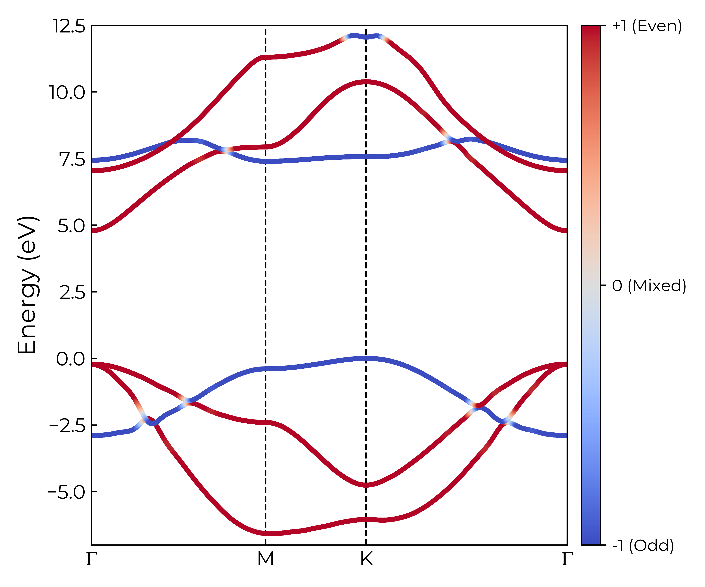
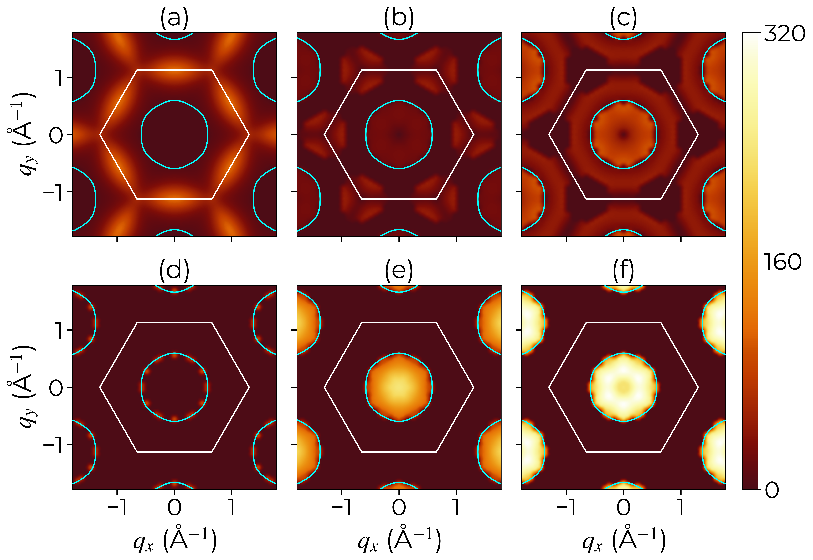
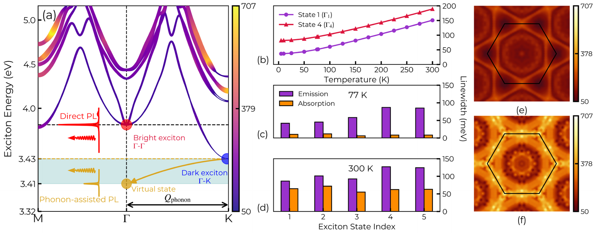
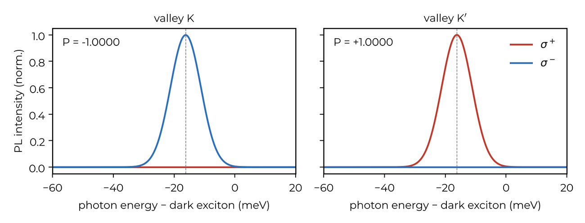
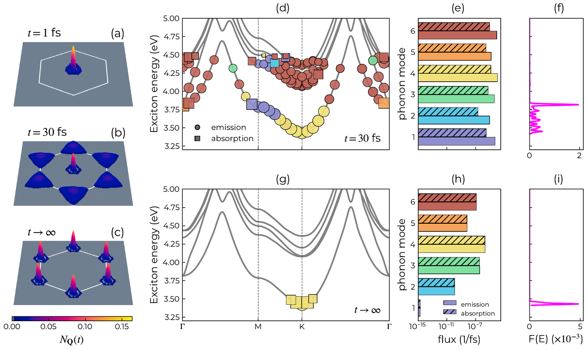

# xphd

**Exciton–phonon physics in two-dimensional semiconductors, from first principles.**
From Quantum ESPRESSO, LetzElPhC and yambo databases, xphd builds exciton–phonon matrix
elements over the whole Brillouin zone and computes broadening-free exciton linewidths,
mirror-parity selection rules, phonon-assisted luminescence and real-time exciton
relaxation. Shown here for monolayer GaN.

R. Saraswat, S. Bhattacharya, R. Verma and M. Ansari — Indian Institute of Information Technology, Allahabad
· version 1.1.0 · MIT licence

<table>
<tr>
<td width="44%"><br>
<sub><b>Mirror parity overlaid on the electron band dispersion.</b> A $\sigma$-like Ga-$s$ conduction band lies below the $\pi^*$ band, opposite in parity to the valence-band maximum, and the gap is indirect.</sub></td>
<td width="56%"><br>
<sub><b>Coupling, branch by branch.</b> |G|² from the bright exciton; the polar branches (e, f) vanish wherever parity forbids them.</sub></td>
</tr>
</table>


<sub><b>Linewidths without broadening.</b> Exciton bands with their 300 K widths, the direct and phonon-assisted
luminescence channels, the width against temperature, emission and absorption, and maps over the zone.</sub>

<table>
<tr>
<td width="100%"><br>
<sub><b>A circularly polarised sideband.</b> The dark exciton emits 16.2 meV below itself, with P = ∓1 in the two valleys.</sub></td>
</tr>
</table>


<sub><b>Real-time relaxation.</b> After injection into the bright state at Γ, the population moves into the K and K′
valleys within about 100 fs; every step is attributed to a phonon branch, by emission or absorption.</sub>

## Install

```bash
pip install -e .                    # the xphd command; numpy only
pip install -e ".[dev]"             # plus scipy, netCDF4, matplotlib and pytest
pytest                              # synthetic data, no databases needed
```

The commands that read yambo databases also need [yambopy](https://github.com/yambo-code/yambopy),
installed from source. On a cluster, add the `hpc` extra after building `mpi4py` against the
cluster's MPI (`scripts/hpc/install_cluster.sh`).

## Start here

| | |
|---|---|
| [`docs/xphd_tutorial.pdf`](docs/xphd_tutorial.pdf) | GaN from start to finish: every command, and what its output should look like |
| [`docs/xphd_guide.pdf`](docs/xphd_guide.pdf) | every command and script, and the methods behind them |
| [`docs/HPC.md`](docs/HPC.md) | MPI, processes and threads; SLURM and PBS job scripts |
| `xphd --help`, `xphd <command> --help` | the options of every command |

## Citing

If you use xphd, please cite the software record on Zenodo
([zenodo.org/records/23232733](https://zenodo.org/records/23232733)); `CITATION.cff` has the details.
